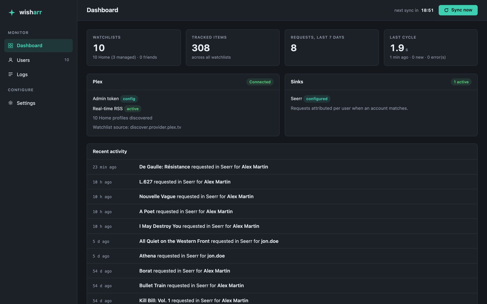
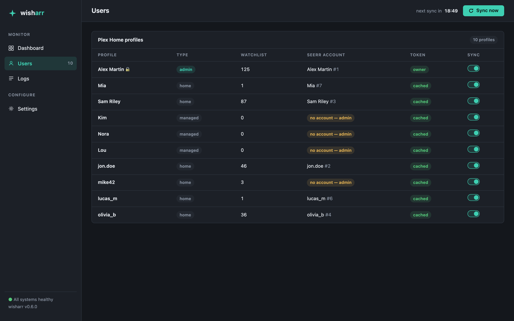
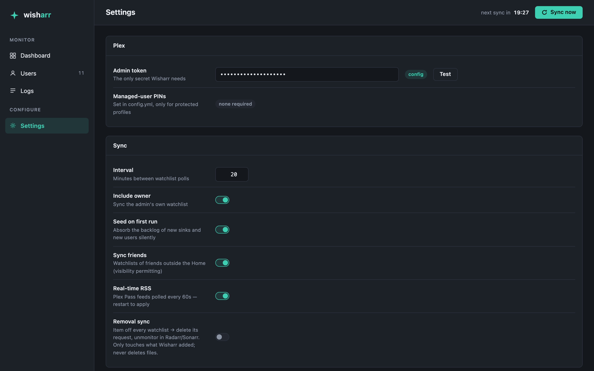

# Wisharr

[](https://github.com/vnguyen42/wisharr/actions/workflows/ci.yml)

Sync Plex watchlists to **Seerr, Radarr and Sonarr**, including **Plex Home managed users** and **friends**, with a **single admin token**. Nobody else has to log in or hand over a token.



<details>
<summary>More screenshots: Users and Settings</summary>




</details>

## Why another watchlist tool?

Most watchlist bridges need a Plex token for every user. Plex Home managed users have no plex.tv login, so their watchlists are usually left out.

| As of October 2026 | Managed users | Friends | Per-user login | Sends to |
|---|---|---|---|---|
| Seerr built-in sync | No | Only users who signed in to Seerr | Yes, once | Seerr |
| [Pulsarr](https://github.com/jamcalli/Pulsarr) | No | Yes, admin token | No | Radarr, Sonarr |
| [Watchlistarr](https://github.com/nylonee/watchlistarr) (no release since 2024) | No | Yes, admin token | No | Radarr, Sonarr |
| Radarr/Sonarr import lists | No | Friends RSS feed, every 6 h, no attribution | No | Radarr, Sonarr |
| **Wisharr** | **Yes** | **Yes, admin token** | **No** | **Seerr, Radarr, Sonarr** |

If you don't need managed users or Seerr, Pulsarr has many more features (routing rules, approvals, notifications).

## How it works

Plex apps switch profiles with `POST plex.tv/api/home/users/{id}/switch`. Wisharr makes the same call with your admin token to get a token for each managed profile, and gets a new one when plex.tv rejects it. Friends' watchlists come from Plex's GraphQL API, also with the admin token only.

New watchlist items become Seerr requests credited to the matching Seerr user, or direct Radarr/Sonarr adds. A local SQLite database remembers what was already sent.

- **Near real-time with Plex Pass:** your watchlist and your friends' watchlist RSS feeds are checked every 60 seconds. Everything else is picked up by the regular sync, every 20 minutes by default.
- **No request flood on first run:** existing watchlists are recorded but not requested. Only items added afterwards are sent (`sync.seedOnFirstRun`).
- **Removal sync (opt-in):** when an item leaves every watchlist, Wisharr deletes its Seerr request or unmonitors it in Radarr/Sonarr. It only touches items it added and never deletes files (`sync.removal`).
- **Web UI on port 9797:** dashboard, users, live logs and settings.

## Quick start (Docker)

```bash
mkdir wisharr && cd wisharr
curl -LO https://raw.githubusercontent.com/vnguyen42/wisharr/main/docker-compose.example.yml
curl -Lo config/config.yml --create-dirs https://raw.githubusercontent.com/vnguyen42/wisharr/main/config/config.example.yml
# Put PLEX_TOKEN and OVERSEERR_API_KEY (your Seerr API key) in a .env file
docker compose -f docker-compose.example.yml up -d
```

Then open http://localhost:9797. Images are multi-arch (amd64, arm64) on `ghcr.io/vnguyen42/wisharr`.

All options are documented in [`config/config.example.yml`](config/config.example.yml). `${VAR}` references are read from environment variables. If Wisharr runs on the same machine as Plex Media Server, `plex.token` can stay empty: it is read from the local Plex install.

<details>
<summary>Run from source</summary>

```bash
cp config/config.example.yml config/config.yml
npm install && npm install --prefix web && npm run --prefix web build
npm run sync   # one sync
npm run dev    # scheduled sync and web UI
```

</details>

## Security

The web UI has no login by default, and its API can read your Plex admin token and your Seerr/Radarr/Sonarr API keys. Keep port 9797 on your local network, or turn on basic auth:

```yaml
ui:
  auth:
    username: admin
    password: ${WISHARR_PASSWORD}
```

The `data/` folder stores Plex tokens for your Home profiles. Protect it and its backups like a password.

## Limitations

- Seerr auto-approves requests made with its API key, so watchlist requests skip Seerr's approval workflow (tested on Overseerr 1.33).
- Users without a Seerr account (usually managed users) get their requests credited to the API key owner.
- Run one Wisharr per database file.

Overseerr and Jellyseerr use the same API as Seerr and work too.

## License

MIT
